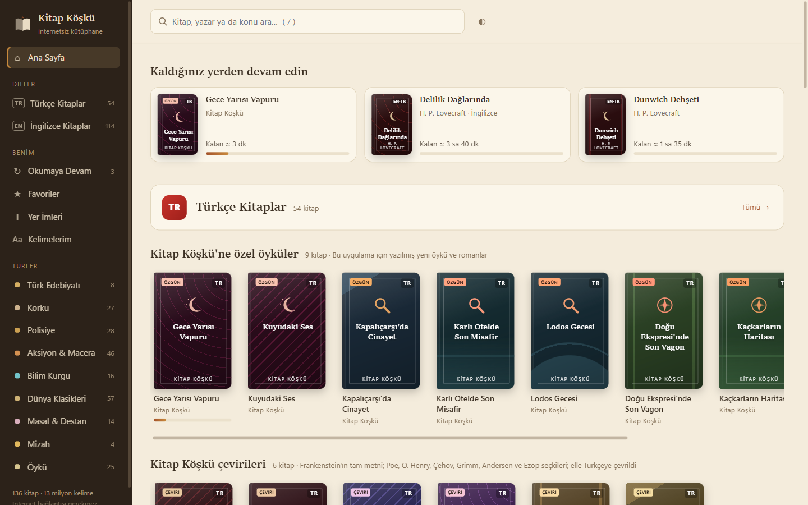
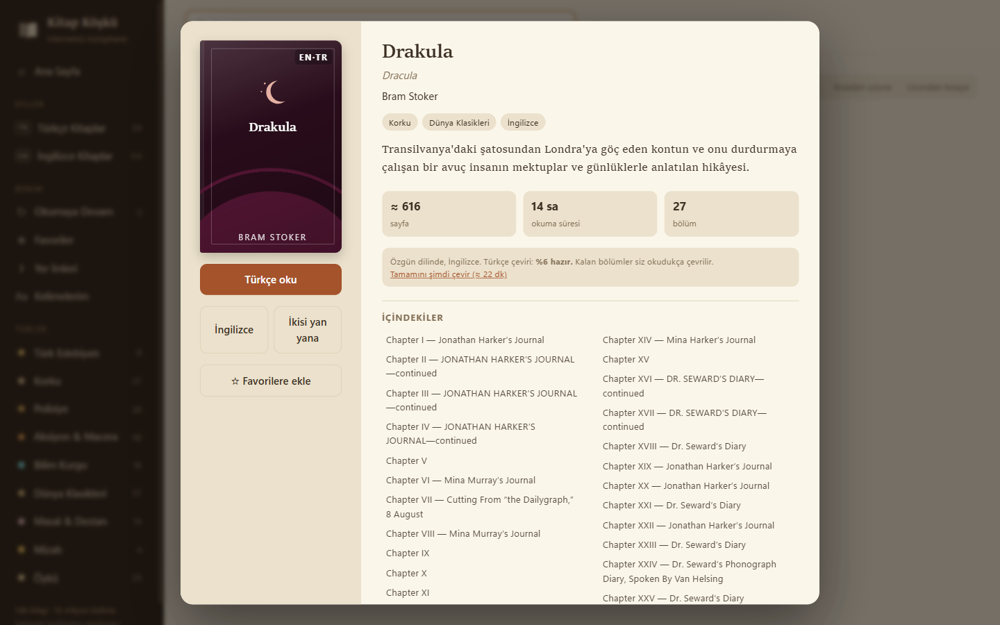
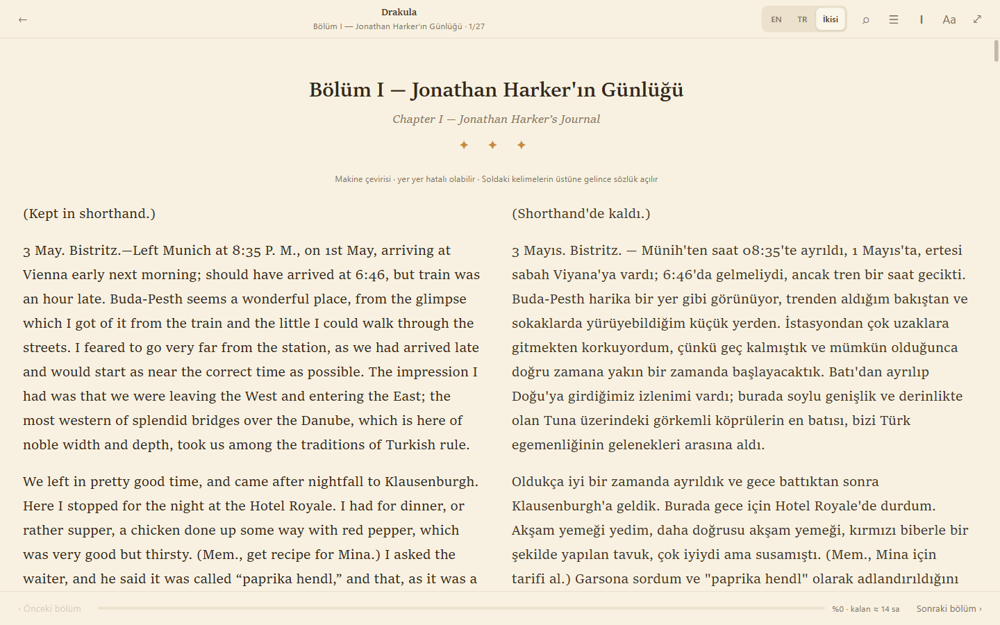

# Kitap Köşkü

İnternetsiz çalışan bir Windows kitap okuma uygulaması. 136 kitap uygulamanın içinde gelir: 22 Türkçe, 114 İngilizce. İngilizce kitaplar Türkçe de okunabilir; 36'sının (22 kısa klasik ve Drakula, Jane Eyre, Suç ve Ceza gibi 14 uzun roman) Türkçesi önceden hazırlanmıştır. Okurken hiç internet kullanılmaz.

## Ekran Görüntüleri

**Ana sayfa:** Kaldığınız yerden devam, türlere ayrılmış raflar ve uygulamaya özel öyküler


**Kitap kartı:** Özet, okuma süresi, içindekiler ve Türkçe çevirinin hazır olma durumu


**Yan yana okuma:** İngilizce özgün metin ve cihaz üstü makine çevirisi aynı ekranda


## İçerik

| Tür | Örnekler |
|---|---|
| Korku | Drakula, Frankenstein, Dr. Jekyll ve Bay Hyde, Poe'nun Eserleri I-III, Lovecraft |
| Polisiye | Sherlock Holmes'un 9 kitabı, Agatha Christie, Peder Brown, Arsène Lupin |
| Aksiyon & Macera | Define Adası, Monte Kristo Kontu, Üç Silahşörler, Jules Verne, Tarzan |
| Bilim Kurgu | Zaman Makinesi, Dünyalar Savaşı, Görünmez Adam, Mars Prensesi |
| Dünya Klasikleri | Suç ve Ceza, Savaş ve Barış, Sefiller, Gurur ve Önyargı, Dönüşüm |
| Türk Edebiyatı | Kürk Mantolu Madonna, Ömer Seyfettin'in 73 hikâyesi, Türk halk masalları |
| Masal & Destan | Grimm, Andersen, Binbir Gece, Dede Korkut uyarlamaları |
| Özgün öyküler | Bu uygulama için yazılmış 8 Türkçe öykü ve *Lodos Gecesi* polisiye romanı (14 bölüm) |
| Kitap Köşkü çevirileri | *Frankenstein*'ın elle yapılmış tam Türkçe çevirisi (28 bölüm, ~51 bin kelime); Poe, O. Henry, Çehov, Grimm ve Andersen'den seçmeler, Ezop masalları |
| Halk edebiyatı | Nasreddin Hoca fıkraları, Keloğlan masalları, Dede Korkut'un 12 hikâyesi |

Özgün öyküler, çeviriler ve halk edebiyatı `originals/` klasöründe Markdown dosyaları olarak durur (`kind: ozgun | ceviri | derleme`). Birden çok satırlı bir paragraf şiir sayılır, satır sonları korunur. Seçilmiş dünya klasiklerinin hazır makine çevirileri `books/ceviri/` altındadır; `python tools/pretranslate.py [kitap…]` ile üretilir.

Yabancı eserler Project Gutenberg'den, özgün dilinde (İngilizce). Türkçe eserler Vikikaynak'tan; yazarlarının telif süresi dolmuştur.

## İngilizce kitapları okumak

- **EN / TR / İkisi:** Okuyucunun üst çubuğundan (ya da L tuşuyla) İngilizce, Türkçe veya iki dil yan yana okunur.
- **Türkçe çeviri:** Bu bilgisayarda, Helsinki-NLP `opus-mt-tc-big-en-tr` modeliyle (CTranslate2, CC BY 4.0) yapılan makine çevirisidir. Açılan bölüm okunan yerden başlanarak çevrilir, sıradaki bölüm arkada hazırlanır. Çeviriler `%APPDATA%\KitapKosku\ceviri\` altında saklanır, bir daha çevrilmez. Kitap kartındaki "Tamamını şimdi çevir" ile bütün kitap arka planda çevrilir (saniyede yaklaşık 110 kelime). Türkçe okurken bir paragrafa tıklayınca İngilizcesi açılır.
- **Kelime ipucu:** İngilizce metinde bir kelimenin üstüne gelince Türkçe anlamları ve kelime türü çıkar ("said → say: demek, söylemek"). Sözlük WikDict en-tr (Vikisözlük, CC BY-SA), kitaplardaki metnin %96'sını kapsar; olmayan kelimeler makine çevirisiyle tamamlanır. Tıklayınca kutu sabitlenir; ☆ ile kelime "Kelimelerim" listesine örnek cümlesiyle kaydedilir.

## Diğer özellikler

- Kütüphane Türkçe ve İngilizce kitaplar olarak iki gruba ayrılır; türe ve ada göre arama
- 4 tema (açık, sepya, koyu, gece), 3 yazı tipi, yazı boyutu, satır aralığı, sütun genişliği
- Kaldığı yeri paragraf düzeyinde ve okunan dille birlikte hatırlar; kalan süre tahmini
- Yer imleri, favoriler, kitap içi arama, içindekiler, tam ekran
- Kısayollar: ← → bölüm, L dil, B yer imi, T içindekiler, F tam ekran, Ctrl+F ara, + / − yazı boyutu, Esc geri

Okuma ilerlemesi `%APPDATA%\KitapKosku\state.json` dosyasında tutulur.

## Geliştirme

```
python tools/build_library.py            # kitapları indirir, books/ klasörüne yazar (bir kez internet gerekir)
python tools/build_library.py --offline  # önbellekten yeniden üretir
python tools/build_dict.py               # İngilizce-Türkçe cep sözlüğü: books/dict-en-tr.json.gz
python dev_server.py                     # http://127.0.0.1:8797 (tarayıcıda test)
python app.py                            # masaüstü penceresi
exe_olustur.bat                          # dist\KitapKosku\KitapKosku.exe + masaüstü kısayolu
```

Çeviri modeli `tools/_models/en-tr-big` altında durur; `exe_olustur.bat` yoksa indirip dönüştürür (~240 MB). Uygulama klasör halinde derlenir (~370 MB); tek dosyalı exe her açılışta modeli geçici klasöre açmak zorunda kalıp yavaşlardı. `KitapKosku.exe --selftest` pencere açmadan çeviri ve sözlüğü dener, sonucu `%APPDATA%\KitapKosku\selftest.txt` dosyasına yazar.

Yeni Gutenberg kitabı eklemek için `tools/sources.py` içindeki `GUTENBERG` listesine satır ekleyip derlemeyi yeniden çalıştırın (sonra `build_dict.py`). Yeni özgün öykü için `originals/` klasörüne aynı başlık biçiminde bir `.md` dosyası koyun (`## ` bölüm başlığı, `---` sahne geçişi).
